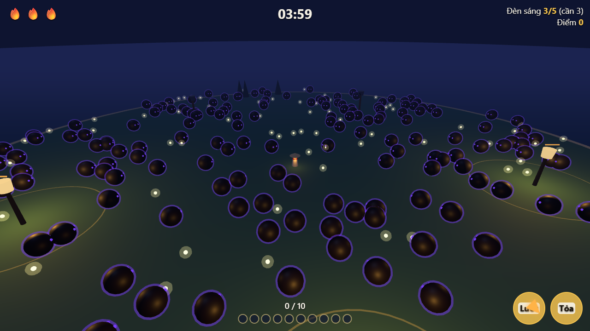

# Đảo Đèn Lồng

> **Video demo (dưới 5 phút):** [demo.mp4 ở Release v1.0.0](https://github.com/hhuydaugg/K5-L3A-DAY12-NguyenHoangHuy-2A202603410-AI-SDLC-Dao-Den-Long/releases/download/v1.0.0/demo.mp4) · **Bản chạy được:** [Release v1.0.0](https://github.com/hhuydaugg/K5-L3A-DAY12-NguyenHoangHuy-2A202603410-AI-SDLC-Dao-Den-Long/releases/tag/v1.0.0)

Game 3D góc nhìn thứ ba chạy trong trình duyệt. Bạn điều khiển Mây, người giữ đèn nhỏ tuổi:
- gom đom đóm và thắp các Đèn Lồng Lớn;
- châm dầu để đèn không tắt;
- đuổi Bóng Mực đang hút dầu;
- giữ đủ đèn cháy tới bình minh.

Có ba Đêm, mỗi Đêm một hòn đảo:
- **Đêm 1 — Đảo Bến:** 5 đèn.
- **Đêm 2 — Đảo Cau:** 2 đảo nối bằng cầu tre, có bục nhảy và Gió Lạc.
- **Đêm 3 — Đảo Chuông:** 3 tầng, có dốc, tháp chuông và gió mạnh.

Bài cá nhân Day 12 (AI SDLC) — Nguyễn Hoàng Huy, 2A202603410.



## Yêu cầu hệ thống

- **Node.js ≥ 18** trên Windows, macOS hoặc Linux. Không cần gói npm nào: three.js đã nằm sẵn trong `web/vendor/`.
- **Trình duyệt có WebGL2:** Chrome, Edge hoặc Firefox bản mới.
- **Chỉ riêng benchmark** cần cài Chrome, Edge hoặc Chromium.
- Đã thử trên Intel Iris Xe (GPU tích hợp của laptop): khoảng 190 FPS ở cảnh nặng nhất (xem mục Benchmark).

## Cài đặt và chạy (3 lệnh)

```bash
git clone https://github.com/hhuydaugg/K5-L3A-DAY12-NguyenHoangHuy-2A202603410-AI-SDLC-Dao-Den-Long.git && cd K5-L3A-DAY12-NguyenHoangHuy-2A202603410-AI-SDLC-Dao-Den-Long
npm install
npm start          # rồi mở http://localhost:8000
```

Không muốn dùng git thì tải `dao-den-long-v1.0.0.zip` ở Release v1.0.0, giải nén, rồi chạy `node web/serve.mjs` trong thư mục đó.

## Điều khiển (đổi được trong Cài đặt)

| Phím mặc định | Việc |
|---|---|
| W A S D | đi lại (theo hướng camera) |
| Kéo chuột / ← → | xoay camera |
| Space | nhảy |
| Shift trái | lướt: 14 m/s trong 0,2 s, hồi chiêu 1,5 s |
| E | thắp đèn gần nhất (trong 2 m), hoặc châm dầu nếu đèn đang sáng |
| F | Tỏa Sáng: tốn 3 đom đóm, làm choáng và đẩy lùi Bóng Mực trong 5 m |
| Esc | tạm dừng: Tiếp tục / Chơi lại Đêm / Cài đặt / Về menu |

**Cài đặt** (được lưu cho lần mở sau):
- âm lượng, độ nhạy chuột;
- đổi phím cho mọi hành động: báo khi trùng phím, có nút "Khôi phục mặc định";
- bảng màu dễ phân biệt;
- giảm chuyển động: tắt rung camera và chớp màn hình;
- chữ lớn ×1,25 (chữ thường đã tối thiểu 18 px ở 1280×720);
- phụ đề và chỉ báo hình ảnh cho các âm thanh quan trọng: Bóng Mực xuất hiện (kèm mũi tên ở mép màn hình), gió sắp thổi, 10 giây cuối, đèn dưới 30 dầu.

## Luật chơi và cách tính điểm

- **Đèn có dầu.**
  - Vừa thắp: đầy 100.
  - Đang sáng: hao 1/s.
  - Hết dầu thì tắt; thắp lại chỉ cần 5 đom đóm.
  - Mỗi đom đóm châm vào được +10 dầu.
- **Đèn dưới 30 dầu mất vùng an toàn.** Bóng Mực tới gần, đứng hút thêm 5 dầu/s. Tỏa Sáng hoặc châm dầu lên ≥ 30 để đuổi chúng.
- **Thắng** khi trời sáng mà Mây còn Ngọn Lửa và còn ít nhất 60% số đèn đang sáng (Đêm 1/2/3: 3/5, 4/6, 5/7). Thắp đủ đèn không kết thúc Đêm sớm.
- **Thua** khi hết 3 Ngọn Lửa, hoặc trời sáng mà không đủ đèn. Đêm 1/2/3 dài 240/270/300 s.
- **Sức chứa** đom đóm: 10, cộng 2 sau mỗi lần thắp, tối đa 20.
- **Rơi khỏi đảo** mất 1 Ngọn Lửa và toàn bộ đom đóm đang mang.

| Sự kiện | Điểm |
|---|---|
| Mỗi đom đóm nạp vào đèn (thắp mới, thắp lại, châm dầu) | +5 |
| Thắp lần đầu / thắp lại | +100 / +40 |
| Bóng Mực trúng Tỏa Sáng | +5 mỗi con; +15 nếu nó đang hút dầu |
| Bình minh, chỉ khi thắng | +50 + floor(dầu) mỗi đèn đang sáng; +50 mỗi Ngọn Lửa còn lại |

**Bảng xếp hạng:**
- Sau màn Bình Minh, hoặc sau khi thua ở bất kỳ Đêm nào, game cho nhập tên: 3–12 ký tự gồm chữ (tiếng Việt có dấu cũng được), số hoặc `_`.
- Điểm là tổng điểm các Đêm đã thắng. Bảng giữ top 10; bằng điểm thì ai đạt trước đứng trên.
- Bảng được lưu ở `data/leaderboard.json` cạnh game (đổi thư mục bằng biến `DDL_DATA_DIR`). Xem từ menu chính.
- Xuất ra file: `node web/serve.mjs --export-leaderboard out.json`.

## Test, headless, benchmark, soak (Test Contract v1.3)

```bash
npm test                        # 48 test: luật, mọi scenario headless, contract, bảng xếp hạng, cảnh bench, soak ngắn
npm run verify -- phase-4       # sinh bằng chứng vào docs/proof/phase-4/
node src/headless.mjs --seed 1 --night 2 --ticks 600 --out run.jsonl \
     [--scenario tests/scenarios/shade_drain.scenario.json] [--inputs file.json] [--snapshot-every 10]
node tools/bench.mjs --seed 42 --duration 30 --out bench.json                              # = npm run bench
node --expose-gc --jitless tools/soak.mjs --seed 7 --nights 10 --out soak.json   # = npm run soak
```

**`game.contract.json`:**
- khai `contract_version: "1.3"` cùng `run_cmd`, `headless_cmd`, `bench_cmd`, `soak_cmd`;
- `tuning` phải trùng `TUNING` trong `src/sim.js` (có test kiểm);
- `shade_speed` là 4,0 cho Đêm 1–2; Đêm 3 dùng 4,5 theo ticket (contract chỉ có một khoá).

**Headless:**
- Mã thoát: 0 khi thành công; 2 khi tham số hoặc file inputs/scenario sai định dạng; 1 khi gặp lỗi khác.
- Một Đêm đầy đủ chạy dưới 1 s.

### Benchmark

`tools/bench.mjs` chạy bản game thật, không phải bản rút gọn.
- **Trình duyệt:** dựng server tạm, mở Chrome/Edge ở chế độ cửa sổ ứng dụng (`--app`) 1280×720, không toàn màn hình.
- **Tắt vsync:** dùng `--disable-gpu-vsync --disable-frame-rate-limit`. FPS đo được (~190) cao hơn tần số quét màn hình, cho thấy vsync đã tắt thật.
- **Cảnh chuẩn** (`createBench` trong `src/sim.js`):
  - Đêm 1, đủ hiệu ứng và ánh sáng;
  - 200 Bóng Mực `wander` và 100 đom đóm, rải đều theo seed;
  - L1–L3 sáng, dầu 100;
  - không sinh thêm, không sát thương, không nhặt, không hao dầu, không kết thúc Đêm.
- **Camera:** bay vòng bán kính 30 m, cao 15 m, 15 s một vòng.
- **Đo:** khởi động 3 s, rồi đo đúng `--duration` giây.
- **Bộ nhớ:** `peak_mem_mb` là `null`, vì trang web không đọc được RSS của tiến trình trình duyệt. `js_heap_peak_mb` là số gần nhất trình duyệt cho biết (heap JS của trang).

Kết quả trên máy tôi (Windows 11, i9-12900H, Intel Iris Xe, Chrome 157), xem `bench.json`:

| avg_fps | p1_low_fps | frame_ms_p95 | load_ms | Ngưỡng |
|---|---|---|---|---|
| 192,4 | 89,9 | 8,6 | 834 | ≥ 60 · ≥ 30 · ≤ 10000 |

### Soak test

- `tools/soak.mjs` chạy 10 Đêm (1 → 2 → 3 → 1 …) trong cùng một tiến trình Node, input ngẫu nhiên theo seed.
- Bộ nhớ đo bằng RSS sau khi gọi `gc()`.
- Chạy với `--jitless`, vì trên Linux riêng bộ nhớ của trình biên dịch JIT đã làm RSS tăng 30–80%, trong khi heap JS chỉ 6–9 MB. Game vẫn chạy đúng code đó, chỉ là bằng trình thông dịch. Số đo trên Node 18/20/22 ở `docs/notes/phase-4.md` (A-26).

Kết quả: `soak.json`, 0 crash, RSS 39,4 → 43,0 MB (tỉ lệ 1,091, ngưỡng 1,2). CI chạy lại soak trên Linux ở mỗi lần push.

## Sáng tạo của tôi

- **Đèn trời:** khi một đèn được thắp, bảy chiếc đèn trời bay lên từ đó.
- **Ông Đăng:** lời dẫn riêng cho từng Đêm ở màn giới thiệu.
- **Âm thanh** tạo bằng WebAudio, không dùng file: nhạc nền đêm và 14 hiệu ứng.
- **Đom đóm rơi nhấp nháy** khi sắp tan.
- **Bóng Mực:** lớn dần khi đang `spawning`, phập phồng khi đang hút dầu.

Mọi phần trên chỉ nằm trong `web/main.js` và không chạm vào `src/sim.js`, nên đầu ra headless không đổi. Trong cảnh benchmark không có phần nào trong số này chạy: không có đèn nào được thắp, không có Bóng Mực nào sinh ra hay hút dầu.

## Tài liệu

- Lịch sử thay đổi theo phase và các thay đổi phá vỡ tương thích: [CHANGELOG.md](CHANGELOG.md).
- Quyết định thiết kế: `docs/adr/`.
- Ghi chép từng phase (giả định, tiêu chí nghiệm thu, test đã sửa, review độc lập): `docs/notes/phase-*.md`.
- Retro cả dự án: [docs/retro.md](docs/retro.md). Nhật ký dùng AI: `docs/notes/ai-log.md`.
- Bằng chứng: `docs/proof/phase-*/`, `bench.json`, `soak.json`.
- Harness AI:
  - `AGENTS.md`;
  - `.claude/settings.json`: Stop hook chạy `npm test`;
  - `.claude/skills/verify-phase/`;
  - CI ở `.github/workflows/ci.yml`.
- Tài liệu lab: [GUIDE.md](GUIDE.md), [CHECKPOINTS.md](CHECKPOINTS.md), [SUBMISSION.md](SUBMISSION.md), [RULES.md](RULES.md), [RUBRIC.md](RUBRIC.md).
- Nguồn tài sản và công cụ AI: [CREDITS.md](CREDITS.md) · Giấy phép: [LICENSE](LICENSE).
